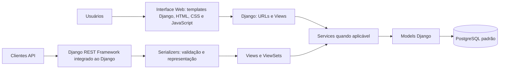

# Visão geral da arquitetura

O projeto é uma aplicação Python/Django organizada em apps. Django fornece o framework web e a organização MTV: Models descrevem persistência, Views processam requisições e Templates renderizam páginas. O Django REST Framework está instalado e integrado ao mesmo processo Django; serializers validam e representam dados da API, e views/viewsets implementam operações. Services existentes concentram regras reutilizáveis de fila e atendimento. URLs e routers publicam as rotas.

A configuração de `senha_system/settings.py` escolhe PostgreSQL por padrão por meio de `DB_ENGINE`; SQLite pode ser selecionado explicitamente ou para testes quando configurado. O frontend identificado no repositório usa templates Django e arquivos estáticos HTML, CSS e JavaScript.

## Arquitetura geral

O fluxo web e a API REST entram no mesmo Django e compartilham services, Models e banco. DRF não é um processo ou serviço independente.

**Legenda:** setas indicam requisições, chamadas internas ou persistência. O banco pode ser SQLite quando a configuração explicitamente seleciona esse backend.
