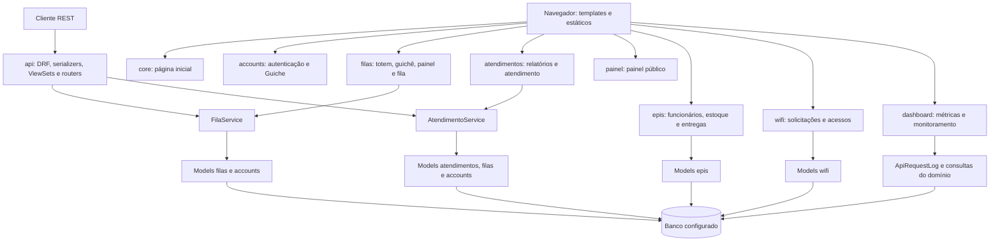

# Componentes Django

Os apps abaixo constam em `INSTALLED_APPS` ou no roteamento raiz. A API é parte do projeto Django e compartilha o domínio e a persistência.

## Dependências e comunicação

## Responsabilidades observadas

| App | Responsabilidade observada |
| --- | --- |
| `core` | Página inicial e rota raiz. |
| `accounts` | Login, contas e entidade `Guiche`. |
| `filas` | Emissão de senha, chamadas, painel e Models de fila; contém `FilaService` e validadores. |
| `atendimentos` | Registros e relatórios; `AtendimentoService` inicia, transfere e finaliza atendimentos. |
| `api` | Endpoints DRF, serializers, ViewSets, router, autenticação/permissões e filtros. Consome Models dos domínios. |
| `painel` | Página e dados do painel público. |
| `dashboard` | Views, services e Model de monitoramento de chamadas à API. |
| `epis` | Funcionários, EPIs, estoque, entregas e relatórios. |
| `wifi` | Solicitações e registros de acesso Wi-Fi. |
| `frontend` | Diretório compartilhado de templates e estáticos configurado em `settings.py`; não é app instalado. |

URLs raiz em `senha_system/urls.py` incluem apps web e `api/`. Os endpoints de recursos DRF são conectados por `api/urls.py` e `api/routers.py`. Services foram documentados somente onde há classes concretas no código.
