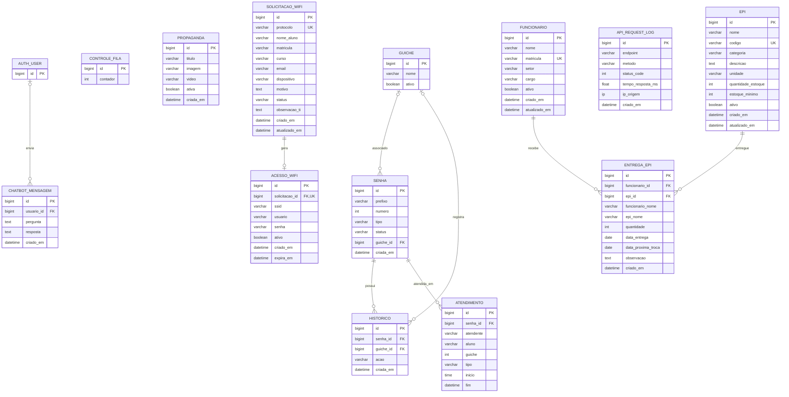

# Modelo entidade-relacionamento

Diagrama derivado das classes `models.Model` atuais em `accounts`, `filas`, `atendimentos`, `wifi`, `epis` e `dashboard`. Campos são resumidos para leitura; PKs `id` são implícitas quando não declaradas. Relações para `auth.User` correspondem ao usuário padrão do Django. Migrations podem conter evolução histórica; este diagrama descreve o estado atual dos Models.

**Observações de integridade:** `Atendimento.guiche` é um inteiro, não uma ForeignKey; portanto não foi desenhada relação para `Guiche`. `ControleFila`, `Propaganda` e `ApiRequestLog` não têm relações explícitas com outras entidades. O estado atual dos Models não declara unicidade composta para a numeração diária de `Senha`.
