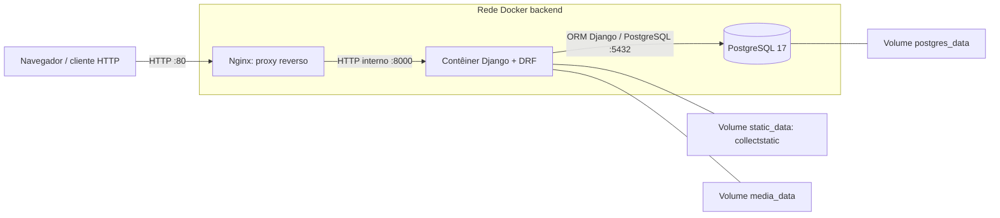

# Implantação

Os arquivos `senha_system/docker-compose.yml`, `docker-compose.prod.yml`, `Dockerfile` e `nginx/default.conf` descrevem uma implantação conteinerizada. O cenário de produção configurado publica Nginx na porta 80 e mantém Django/Gunicorn e PostgreSQL na rede Docker `backend`.

## Topologia configurada

## Responsabilidades e limites

- **Navegador/cliente:** consome páginas servidas pelo Django e recursos estáticos; clientes REST enviam HTTP para as rotas `/api/` da mesma aplicação.
- **Nginx:** proxy encaminha requisições para `web:8000` e propaga cabeçalhos de host, IP e protocolo. A configuração fornecida escuta na porta 80; TLS não aparece configurado nela.
- **Django + DRF:** um contêiner `web`, imagem baseada em Python 3.13, executa migrations, coleta arquivos estáticos e inicia Gunicorn com `senha_system.wsgi:application` e três workers.
- **PostgreSQL:** imagem `postgres:17`, credenciais e nome recebidos por variáveis de ambiente, volume persistente e healthcheck.
- **Volumes:** `static_data`, `media_data` e `postgres_data` são declarados no Compose.

O Compose de desenvolvimento publicado expõe Nginx na porta 8081 e chama a rede `guiche_network`; o de produção publica a porta 80 e chama a rede `backend`. Não há configuração efetiva de TLS, balanceador externo, orquestrador ou provedor de nuvem nesses arquivos, portanto tais componentes não são representados.

## Execução local

`manage.py` fica em `senha_system/`. Configure as variáveis requeridas por `senha_system/senha_system/settings.py`, instale as dependências de `senha_system/requirements.txt`, execute `python manage.py migrate` e `python manage.py runserver` a partir da pasta `senha_system`. A configuração de banco depende do ambiente: PostgreSQL é o padrão; SQLite pode ser selecionado via `DB_ENGINE`.
