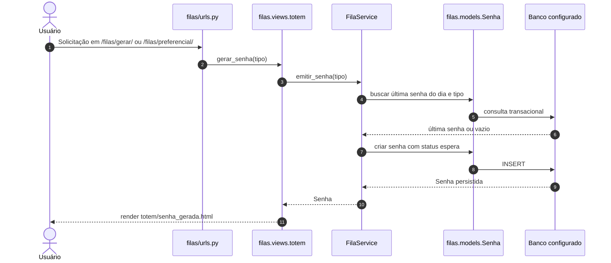
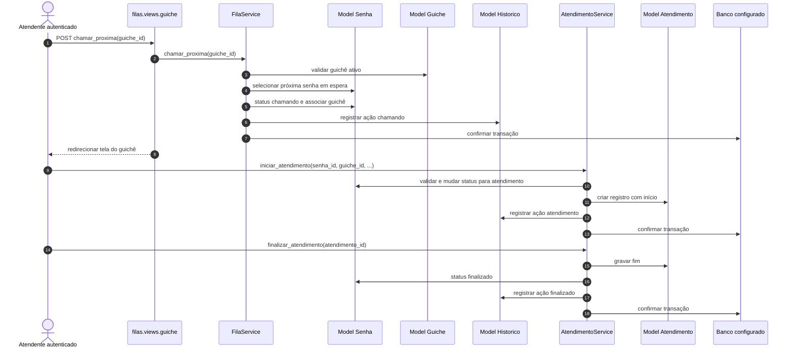

# Diagramas de sequência

Os cenários abaixo seguem os handlers web e services existentes. O caminho alternativo via API é indicado onde o código chama o mesmo service.

## Emissão de senha e entrada na fila

## Chamada, atendimento e finalização

**Legenda:** `DB` representa o backend selecionado na configuração. Cada service opera em transação atômica conforme o código.
